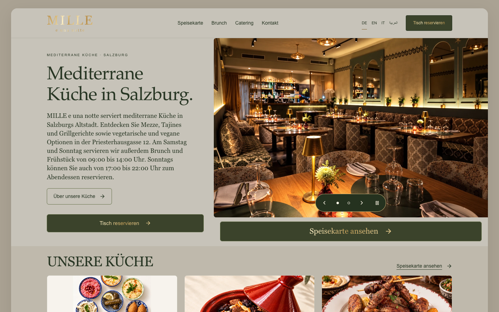
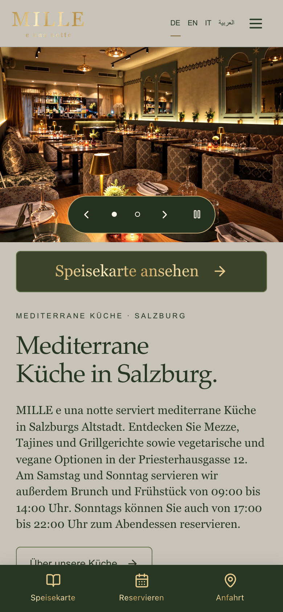
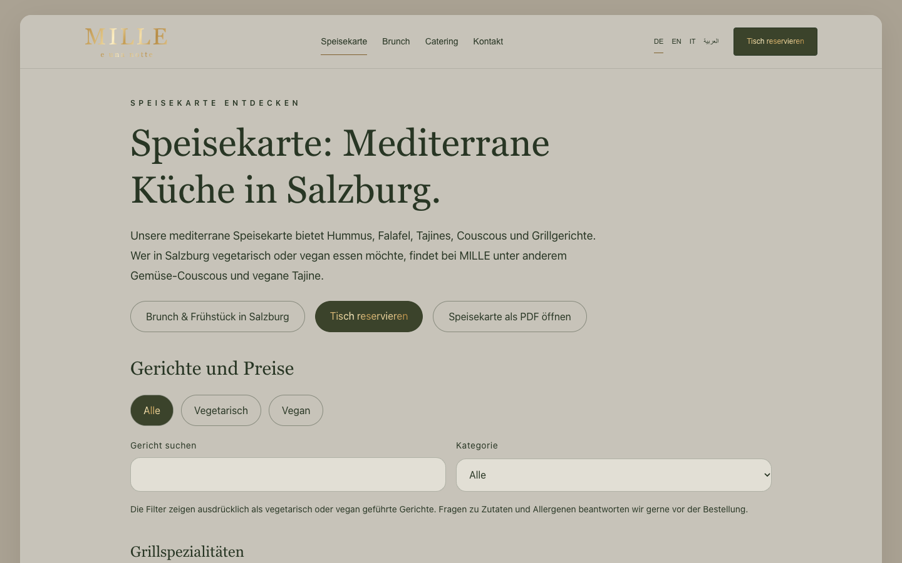
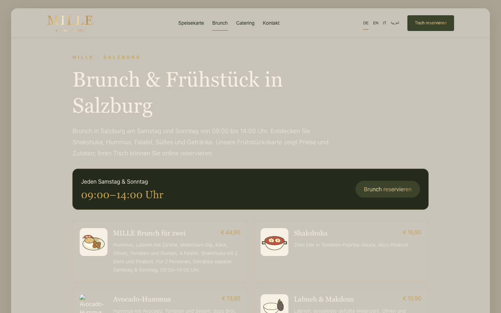
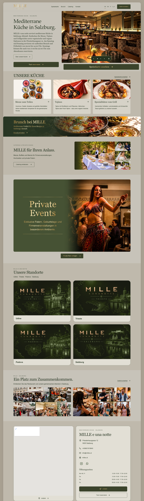

# MILLE — Salzburg

> Website and content dashboard for a Mediterranean restaurant in Salzburg's old town.

**Live:** [milles.at](https://milles.at/) · **Role:** Developer · **Period:** 2026 · **For:** Client (Austria)

    

## Overview

A multilingual restaurant website where the owners manage every image, text, menu category, location and SEO setting from a dashboard.

## What it does

- German / English / Italian
- Dashboard-managed hero images, locations and translations
- Localized menu categories and PDF menu
- Persistent SEO settings, sitemap and share metadata

## Engineering highlights

- Server-rendered page metadata and canonical links for SEO
- Production deploys only after the test workflow passes
- 70+ commits

## Screenshots (live site)

  
  
  

Full home page

---

Source code is private (client / commercial project). This repository documents the work only.

Built by **Ahmed Gamal** — Senior Laravel Developer · [LinkedIn](https://www.linkedin.com/in/wzcoder/) · [GitHub](https://github.com/ahmed-gamal-dev)
